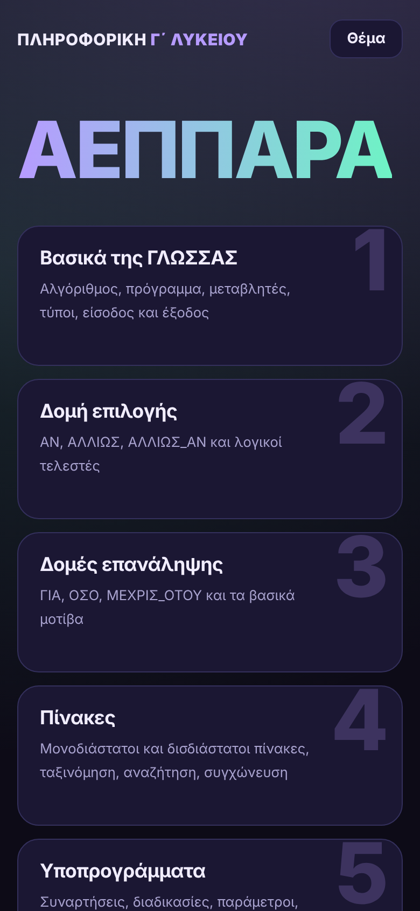
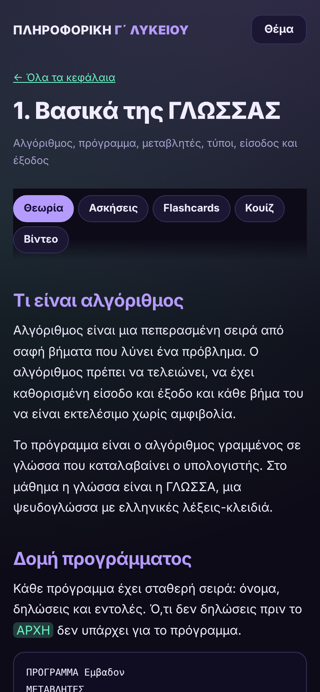
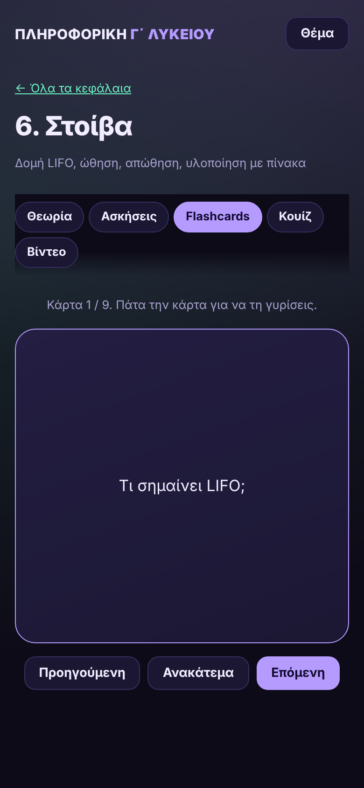
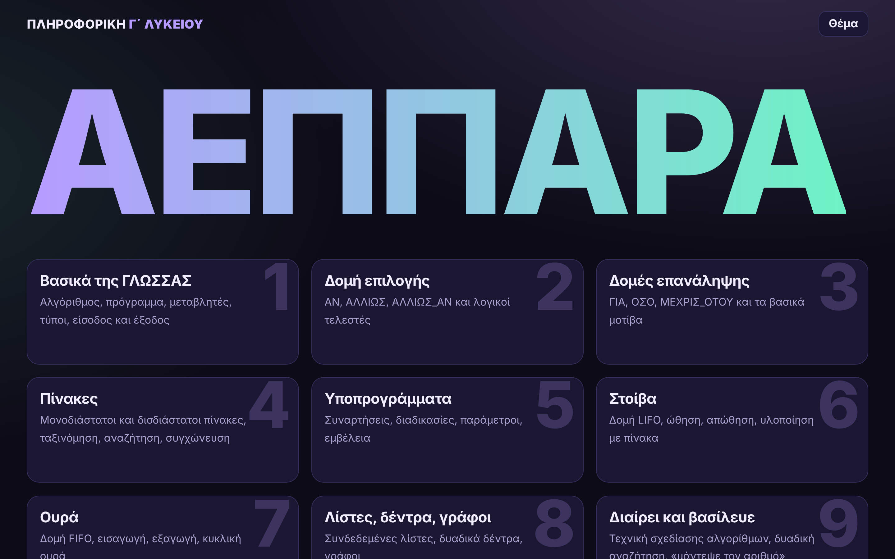

# ΑΕΠΠΑΡΑ

Διαδραστικός οδηγός μελέτης για το μάθημα **Ανάπτυξη Εφαρμογών σε Προγραμματιστικό Περιβάλλον** της Γ΄ Λυκείου. Επιλέγεις κεφάλαιο και βρίσκεις θεωρία, ασκήσεις με λύσεις, flashcards, κουίζ και βίντεο.

**Ζωντανή σελίδα:** https://matsouka-maria.github.io/AEPPARA/

  
  
  

## Τι περιέχει

Κάθε κεφάλαιο έχει πέντε καρτέλες:

| Καρτέλα | Περιεχόμενο |
|---|---|
| Θεωρία | Πλήρης θεωρία με δικά μου λόγια και παραπομπές στα επίσημα βιβλία |
| Ασκήσεις | Ασκήσεις με υποδείξεις που ξεκλειδώνουν μία-μία και λύσεις |
| Flashcards | Κάρτες με ερώτηση και απάντηση, με ανακάτεμα |
| Κουίζ | Ερωτήσεις πολλαπλής επιλογής με άμεση διόρθωση |
| Βίντεο | Έτοιμες αναζητήσεις στο YouTube για το κεφάλαιο |

## Κεφάλαια

1. Βασικά της ΓΛΩΣΣΑΣ
2. Δομή επιλογής
3. Δομές επανάληψης
4. Πίνακες
5. Υποπρογράμματα
6. Στοίβα
7. Ουρά
8. Λίστες, δέντρα, γράφοι
9. Διαίρει και βασίλευε
10. Δομή ΕΠΙΛΕΞΕ
11. Αντικειμενοστρεφής προγραμματισμός
12. Εκσφαλμάτωση

Η σελίδα έχει εργαλεία που δείχνουν βήμα προς βήμα τη στοίβα, την ουρά, την ταξινόμηση φυσαλίδας και τη δυαδική αναζήτηση. Δουλεύει σε κινητό, tablet και υπολογιστή, με σκούρο και ανοιχτό θέμα.

## Αρχεία

| Αρχείο | Ρόλος |
|---|---|
| `index.html` | Η σελίδα |
| `style.css` | Εμφάνιση και προσαρμογή στην οθόνη |
| `core.js` | Σύνδεσμοι προς τα βιβλία |
| `d1.js`, `d2.js`, `d3.js` | Περιεχόμενο των κεφαλαίων 1 έως 12 |
| `main.js` | Λογική της σελίδας |

## Τοπική εκτέλεση

Κατέβασε το repository και άνοιξε το `index.html` στον browser. Δεν χρειάζεται server.

## Πηγές

Οι παραπομπές οδηγούν στα επίσημα βιβλία του ΙΤΥΕ «Διόφαντος» στο ebooks.edu.gr: βιβλίο μαθητή, οδηγίες μελέτης, συμπληρωματικό εκπαιδευτικό υλικό, λύσεις ασκήσεων και τετράδιο μαθητή. Η θεωρία και οι ασκήσεις της σελίδας είναι ξαναγραμμένες με δικά μου λόγια.
